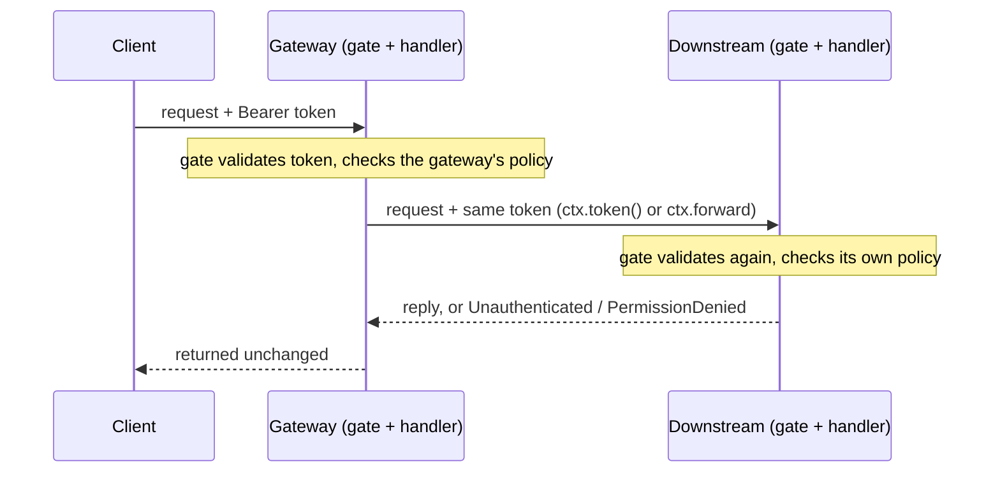

# Calling services

See [Concepts](concepts.md) for how the pieces fit. The [service template](https://github.com/fermi-ad/rust-grpc-service-template) is a runnable example service.

A client-only crate needs just `rust-grpc-lib` (no feature) and `tokio` in `[dependencies]`, plus `rust-grpc-lib` with `build` in `[build-dependencies]` for proto generation; see the [server guide](server.md#adding-the-dependency) for the details, which are the same. No `tonic`, `prost` or `tonic-prost` dependency is needed: use `rust_grpc_lib::tonic::..` (for example `rust_grpc_lib::tonic::transport::Channel` or `rust_grpc_lib::tonic::Status`) and `rust_grpc_lib::prost::..` when you name their types. The library emits `tracing` events but installs no subscriber; add `tracing-subscriber` if you want to see them.

## Generated clients

Every generated client derives `GrpcClient`, which adds two constructors:

```rust
FooClient::public(endpoint: &str)
    -> Result<FooClient<Channel>, ChannelError>

FooClient::authenticated(endpoint: &str, provider: P)   // P: TokenProvider
    -> Result<FooClient<AuthenticatedClient<P>>, ChannelError>
```

- `public` sends no token. Use it for methods the server marks `#[public]`; see [Public clients](#public-clients).
- `authenticated` attaches the provider's token to every request. Use it for methods behind an access policy (`#[roles(..)]` or `#[any_authenticated]`).

The target method's policy decides which to use, and the server's gate is the authority: a gated method called without a valid token answers `Unauthenticated`.

A service calling on its own behalf uses `FileTokenProvider`, which reads its own credentials from a file and caches them:

```rust
use rust_grpc_lib::auth::FileTokenProvider;
use crate::proto::services::alarm_commands::alarm_commands_client::AlarmCommandsClient;

let mut client = AlarmCommandsClient::authenticated(
    "http://alarm-host:50051",
    FileTokenProvider::from_env()?,   // SERVICE_TOKEN_FILE
)?;
```

A tool that already holds a **user's** token (for example one a CLI received from its user) wraps it in a `ForwardedToken`:

```rust
use rust_grpc_lib::auth::ForwardedToken;

let user_token = std::env::var("USER_TOKEN")?;
let mut client = AlarmCommandsClient::authenticated(
    "http://alarm-host:50051",
    ForwardedToken::new(user_token),
)?;
```

`ForwardedToken` carries a user's credentials, never a service's own identity. Inside a service handler, `ctx.token()` is the way to get one (see [Forwarding the caller's token](#forwarding-the-callers-token)); `ForwardedToken::new(..)` is for tools and tests.

- **Runtime.** Call either constructor inside a Tokio runtime; outside one it returns `ChannelError::Runtime` rather than panicking.
- **Connection.** Lazy: only an invalid URI fails here (`ChannelError::Transport`). An unreachable host surfaces as an error status at the first RPC.
- **Token.** For `authenticated`, fetched from the provider on **every** request and sent as a sensitive `authorization: Bearer <token>` header. A provider error fails the call with `Unauthenticated`; a token that is not a valid header value fails it with `Internal` (the message never echoes the token).
- **Storing a client.** `AuthenticatedClient<P>` (`rust_grpc_lib::auth`) names the transport: `ExampleDbClient<AuthenticatedClient<ForwardedToken>>`. A `public` client is `ExampleDbClient<rust_grpc_lib::tonic::transport::Channel>`.
- **Your own wrapper.** `#[derive(GrpcClient)]` also works on a tonic-style type with one type parameter and a `new(inner)` constructor.
- **Name collisions.** The constructors are inherent associated functions, so an RPC whose snake_case name is `public` or `authenticated` collides with them and the build fails with `E0592` (duplicate definitions). Rename the RPC in the `.proto` file.

`ChannelError` (`rust_grpc_lib::pool`) is `#[non_exhaustive]`, so match it with a wildcard arm; it implements `std::error::Error`, so `?` converts it into `Box<dyn Error>`.

## Token providers

| Provider | Use for |
|---|---|
| `ctx.token()` | Inside a handler: the caller's (a user's) token as a `ForwardedToken`, to call another service as that user |
| `ForwardedToken::new(token)` | Tools and tests that already hold a user's token. It has no `Debug` or `Display`, so it cannot be printed by accident. Not for a service's own identity |
| `FileTokenProvider` | A service's own credentials, read from a file and cached; `FileTokenProvider::from_env()` reads the variables below |
| Your own `impl TokenProvider` | Any other source: `fn get_token(&self) -> Result<String, TokenError>` |

## Forwarding the caller's token

A handler that calls another service as its caller (a gateway or resolver) passes the same token on:



There are two ways to attach it:

```rust
// A generated client whose every call carries the caller's token.
let mut downstream = ExampleDbClient::authenticated(&url, ctx.token())
    .map_err(|err| Status::unavailable(err.to_string()))?;

// A plain tonic client on your own channel: the context's own message in a
// request with the header set. No clone; this consumes the context.
downstream_plain.get_end_point_two(ctx.into_forwarded()).await
```

`ctx.forward(other_message)` does the same for a different message and borrows the context. `ctx.into_parts()` gives `(message, ForwardedToken)` when you need both by value.

The downstream service validates the token again and applies its own policy; its `Unauthenticated` or `PermissionDenied` comes back unchanged, so both services must trust the same issuer. The gate checks expiry only when the call starts, so check `ctx.is_expired()` before forwarding from a long-running handler. To test forwarding, see [Live-server tests](testing.md#live-server-tests).

## Channel pool

Generated constructors call `rust_grpc_lib::pool::get_channel(endpoint)`; call it yourself only to give a plain tonic client a pooled channel.

- One lazily connected HTTP/2 channel per **normalized** endpoint, shared process-wide. Scheme and host case (`HTTP://Host:50051` and `http://host:50051`) and a lone trailing `/` (`http://h:50051` and `http://h:50051/`) do not make a separate entry. A different port (default ports are not stripped), userinfo, other path or query does. The channel connects to the first string seen for the endpoint. Entries are never evicted.
- Auth lives in each client's interceptor, so clients with different providers share one channel, and building a client per call is cheap.
- `get_channel` needs a Tokio runtime on every call, even for an endpoint already in the pool.

## Environment variables

| Variable | Default | Read by |
|---|---|---|
| `RUST_GRPC_LIB_KEEP_ALIVE_INTERVAL_SECS` | 30 | The pool, when an endpoint's channel is first created |
| `RUST_GRPC_LIB_KEEP_ALIVE_TIMEOUT_SECS` | 10 | The pool, likewise |
| `SERVICE_TOKEN_FILE` | none (required) | `FileTokenProvider::from_env()` |
| `SERVICE_TOKEN_CACHE_TTL_SECS` | 30 | `FileTokenProvider::from_env()` |

An unset or unparsable keep-alive value logs a `tracing` warning and the default is used. Keep-alive while idle is always on. Because a channel is created once per endpoint, later changes to these variables do not affect it. Server-side variables are in the [server guide](server.md#environment-variables).

## Public clients

Servers get the tools to be secure: per-method access policies, enforced by the gate that `GrpcServer::add_service` installs. Clients get the tools to call the servers they need: `public` sends no token, and `authenticated` attaches one. The target method's policy decides which to use, and the server's gate is the authority: a gated method called without a valid token answers `Unauthenticated`.

```rust
// No token: for methods the server marks #[public].
let mut client = FooClient::public("http://foo-host:50051")?;
let reply = client.bar(Empty {}).await?.into_inner();
```

`public` takes a channel from the same pool and has the same runtime and connection behavior as `authenticated`. Both constructors are generated for every client, so a client can call a mix of public and gated methods by building one of each (building a client is cheap).
