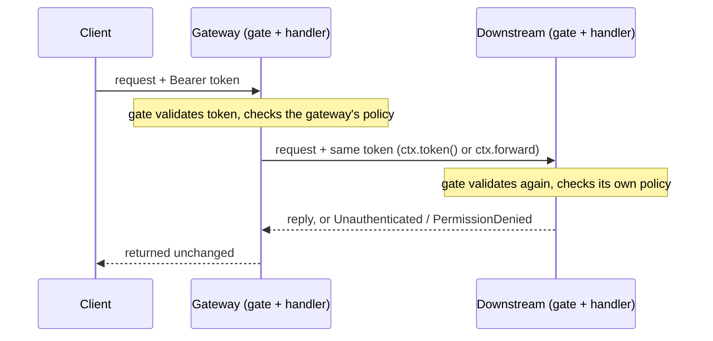

# Calling services

How to call a gRPC service from Rust with the generated clients: choosing `public` or `authenticated`, supplying tokens, forwarding a caller's token from inside a handler, and how channels are pooled. Dependencies and proto generation are the same as for servers, minus `server` and `jwks-url` (see [Adding the dependency](server.md#adding-the-dependency)).

## Call a service

Every generated client derives `GrpcClient`, which adds two constructors:

```rust
FooClient::public(endpoint: &str)
    -> Result<FooClient<Channel>, ChannelError>

FooClient::authenticated(endpoint: &str, provider: P)   // P: TokenProvider
    -> Result<FooClient<AuthenticatedClient<P>>, ChannelError>
```

The target method's policy decides which to use; the server's gate is the authority.

| Method policy on the server | Constructor | Without the right one |
|---|---|---|
| `#[roles(..)]`, `#[any_authenticated]` | `authenticated` | `Unauthenticated` |
| `#[public]` | `public` (sends no token) | n/a |

```rust
// No token: for methods the server marks #[public].
let mut client = FooClient::public("http://foo-host:50051")?;
let reply = client.bar(Empty {}).await?.into_inner();
```

A client that needs both kinds of methods builds one of each; building is cheap.

### As a service: your own credentials

`FileTokenProvider` reads the service's own token from a file and caches it:

```rust
use rust_grpc_lib::auth::FileTokenProvider;

let mut client = ExampleDbClient::authenticated(
    "http://example-host:50051",
    FileTokenProvider::from_env()?,   // SERVICE_TOKEN_FILE
)?;
let reply = client.get_end_point_two(IdList::default()).await?;
```

### As a user: a token you already hold

A tool that has a **user's** token (for example one a CLI received from its user) wraps it in `ForwardedToken`:

```rust
use rust_grpc_lib::auth::ForwardedToken;

let user_token = std::env::var("USER_TOKEN")?;
let mut client = ExampleDbClient::authenticated("http://example-host:50051", ForwardedToken::new(user_token))?;
```

`ForwardedToken` carries a user's credentials, never a service's own identity. It has no `Debug` or `Display`, so it cannot be printed by accident. Inside a handler use `ctx.token()` instead (next section).

### Token providers

| Provider | Use for |
|---|---|
| `FileTokenProvider` | A service's own credentials, read from a file and cached. `from_env()` reads the variables in [Environment variables](#environment-variables) |
| `ctx.token()` | Inside a handler: the caller's token, to call another service as that caller |
| `ForwardedToken::new(token)` | Tools and tests that already hold a user's token |
| Your own `impl TokenProvider` | Any other source: `fn get_token(&self) -> Result<String, TokenError>` |

### Constructor behavior

- **Runtime.** Call a constructor inside a Tokio runtime; outside one it returns `ChannelError::Runtime`, not a panic.
- **Connection.** Lazy. Only an invalid URI fails at construction (`ChannelError::Transport`); an unreachable host fails the first RPC (typically `Unavailable`).
- **Token.** `authenticated` asks the provider for a token on **every** request and sends it as a sensitive `authorization: Bearer <token>` header. A provider error fails the call with `Unauthenticated`; a token that is not a valid header value fails it with `Internal "token contains invalid header characters: .."` (the token itself is never echoed).
- **Storing a client.** Name the transport: `ExampleDbClient<rust_grpc_lib::auth::AuthenticatedClient<ForwardedToken>>` for `authenticated`, `ExampleDbClient<rust_grpc_lib::tonic::transport::Channel>` for `public`.
- **Your own wrapper.** `#[derive(GrpcClient)]` also works on a tonic-style type with one type parameter and a `new(inner)` constructor.
- **Name collisions.** The constructors are inherent associated functions, so an RPC whose snake_case name is `public` or `authenticated` fails to build with `E0592` (duplicate definitions). Rename the RPC in the `.proto` file.
- **Errors.** `ChannelError` (`rust_grpc_lib::pool`) is `#[non_exhaustive]`: match it with a wildcard arm. It implements `std::error::Error`, so `?` converts it into `Box<dyn Error>`.

## Forward the caller's token

A handler that calls another service as its caller (a gateway or resolver) passes the caller's token on:



```rust
// A generated client whose every call carries the caller's token.
let mut downstream = ExampleDbClient::authenticated(&url, ctx.token())
    .map_err(|err| Status::unavailable(err.to_string()))?;
downstream.get_end_point_two(IdList::default()).await

// A plain tonic client on a pooled channel: the context's own message in a
// request with the header set. Consumes the context; no clone.
let channel = rust_grpc_lib::pool::get_channel(&url).map_err(|err| Status::unavailable(err.to_string()))?;
ExampleDbClient::new(channel).get_end_point_two(ctx.into_forwarded()).await
```

| Method | Result |
|---|---|
| `ctx.token()` | The caller's token as a `ForwardedToken`, for `authenticated` |
| `ctx.into_forwarded()` | `tonic::Request<T>` with `ctx.message` and the token header; consumes the context |
| `ctx.forward(msg)` | The same for a different message; borrows the context |
| `ctx.into_parts()` | `(message, ForwardedToken)` when you need both by value |

- The downstream service validates the token again and applies its own policy. Its `Unauthenticated` or `PermissionDenied` comes back unchanged, and both services must trust the same issuer.
- Expiry is checked only when a call starts. In a long-running handler, check `ctx.is_expired()` before forwarding.
- The header is omitted if the token is not a valid header value, so the downstream answers `Unauthenticated "missing Authorization header"`.
- To test forwarding, see [Test a service](testing.md#test-a-service-end-to-end).

## Channel pool

Generated constructors call `rust_grpc_lib::pool::get_channel(endpoint)`; call it yourself only to give a plain tonic client a pooled channel.

- One lazily connected HTTP/2 channel per **normalized** endpoint, shared process-wide and never evicted. Scheme and host case (`HTTP://Host:50051` and `http://host:50051`) and a lone trailing `/` do not create separate entries. A different port (default ports are not stripped), userinfo, other path or query does. The channel connects to the first string seen for the endpoint.
- Auth lives in each client's interceptor, so clients with different providers share one channel.
- `get_channel` needs a Tokio runtime on every call, even for an endpoint already pooled.
- Channels use no TLS settings: the infra team handles TLS.

## Environment variables

| Variable | Default | Read by |
|---|---|---|
| `SERVICE_TOKEN_FILE` | none (required; `ConfigError` if unset) | `FileTokenProvider::from_env()` |
| `SERVICE_TOKEN_CACHE_TTL_SECS` | 30 (an unparsable value also gives 30) | `FileTokenProvider::from_env()` |
| `RUST_GRPC_LIB_KEEP_ALIVE_INTERVAL_SECS` | 30 | The pool, once per endpoint, when its channel is created |
| `RUST_GRPC_LIB_KEEP_ALIVE_TIMEOUT_SECS` | 10 | The pool, likewise |

An unset or unparsable keep-alive value logs a `tracing` warning and uses the default. Keep-alive while idle is always on. Because each channel is created once, set these before the first client for that endpoint; later changes have no effect. Server-side variables are in the [server guide](server.md#environment-variables).
