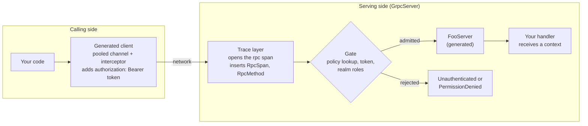

# Concepts

How the pieces of `rust-grpc-lib` fit together. It assumes basic async Rust, not tonic, JWTs or Keycloak. For a runnable example service, see the [service template](https://github.com/fermi-ad/rust-grpc-service-template).

## The pieces

**Build time.** Your `build.rs` calls `generate_protos`, which compiles every bundled controls `.proto` into `$OUT_DIR/proto.rs`. You include that file once. It contains, per proto service, a tonic client (`FooClient`), a trait you implement (`Foo`) and a server type that wraps your implementation (`FooServer`). The protos come only from the org-wide [interface-definitions](https://github.com/fermi-ad/interface-definitions) repository, so all services and clients share one set of generated types; for a new or changed RPC, change it there, run the bump workflow and bump your `tag`. See [Generating the protos](server.md#generating-the-protos).

**One call at run time:**

The gate strips the `authorization` header on every path, so neither a handler nor a rejection ever sees the token.

**Dependencies.** Everything tonic-related comes through `rust-grpc-lib`: it re-exports `tonic`, `prost` and the `async_trait` attribute, the macros and generated code refer only to `::rust_grpc_lib`, and the health service is built in. A service depends on `rust-grpc-lib`, `tokio`, `tracing` and `tracing-subscriber`; a client on `rust-grpc-lib` and `tokio`. The library emits `tracing` spans and events but never installs a subscriber, so the application does. See [Adding the dependency](server.md#adding-the-dependency).

**Security assumption.** Services operate over plaintext, and TLS is handled by the infra team, not by this library. Bearer tokens therefore travel unencrypted between the service and the platform's TLS layer, so a service must only be reachable through that layer and should bind to trusted interfaces. The library never logs tokens.

**Who enforces what.** Servers get the tools to be secure: per-method access policies, enforced by the gate that `GrpcServer::add_service` installs. Clients get the tools to call the servers they need: `GrpcClient`'s `public` constructor sends no token, and `authenticated` attaches one. The target method's policy decides which to use, and the server's gate is the authority: a gated method called without a valid token answers `Unauthenticated`.

- **Client.** Every generated client takes a channel from the process-wide **channel pool** (one lazily connected HTTP/2 channel per normalized endpoint). `public(url)` uses it as is; `authenticated(url, provider)` adds a `ClientJwtInterceptor`, which asks the **token provider** for a token on every request. See the [client guide](client.md).
- **Server.** `GrpcServer::builder(validator)` installs the **trace layer** (outermost, on every call including health and rejections) and wraps each service added with `add_service` in a **gate**. The gate is the only place access is enforced. See the [server guide](server.md).
- **Policies.** `#[access_controlled_service]` on your `impl` declares one policy per method and emits the **policy table** the gate reads. The macro checks nothing itself. `add_service` only accepts annotated implementations, so a service cannot be served without a table, and auth cannot be switched off.
- **Contexts.** Handlers receive a `RequestContext<T>` (validated claims plus message) or, for `#[public]` methods, a `PublicContext<T>` (message only), never a raw `tonic::Request`. Both dereference (read-only) to `CallInfo` (method, peer, metadata, span).
- **Forwarding.** Inside a handler, `ctx.token()`, `ctx.forward(msg)` or `ctx.into_forwarded()` passes the caller's token to a downstream service, which validates it again. See [Forwarding the caller's token](client.md#forwarding-the-callers-token).

## Glossary

| Term | Meaning |
|---|---|
| Package to module | A proto `package a.b;` becomes the Rust module `a::b`, with tonic naming: `ExampleDB` in `package services.example;` is `proto::services::example::example_db_server::ExampleDbServer`. See [Generating the protos](server.md#generating-the-protos). |
| JWT / bearer token | A signed string saying who the caller is, sent as `authorization: Bearer <token>`. Anyone holding it can act as the caller, so the library never logs it. |
| Keycloak, realm role | Keycloak signs the tokens. A realm role (such as `operator`) is listed in the token's `realm_access.roles`. **Only realm roles count**: a client role (`resource_access.<client>.roles`) never satisfies `#[roles(..)]`. |
| Claims | The contents of a validated token: `KeycloakClaims`, with `sub` (who) and `exp` (expiry). In a handler: `ctx.claims`, `ctx.sub()`, `ctx.has_role(..)`. |
| Token provider | Supplies tokens to send (`TokenProvider`). `ctx.token()` returns a `ForwardedToken`, a user's token that a service passes along; `ForwardedToken::new(..)` wraps a user's token you already hold (tools, tests). `FileTokenProvider` (file, cached) is a service's own identity. |
| Token validator | Checks tokens (`TokenValidator`). `KeyValidator` verifies signatures against keys from a JWKS URL (`jwks-url` feature), a JWKS file, a PEM file or a string. |
| Access policy | `#[roles(any(..))]`, `#[roles(all(..))]`, `#[any_authenticated]` or `#[public]`; exactly one per method. |
| Policy table | What the macro emits: `ServicePolicy`, read through `PolicyTable`, entries `MethodPolicy` with an `Access`. |
| Fail closed | When unsure, deny: a method missing from the table gets `PermissionDenied`; a context built without the gate gets `Internal`. |
| Health | `grpc.health.v1.Health`, served automatically by `GrpcServer` (no `tonic-health` dependency); needs no token. Tests query it with `testing::health_status` / `health_watch`. |
| Conformance check | `assert_policy_table_conforms` (`test-util`) calls a live server to check that it enforces the table. See [testing](testing.md). |

Token expiry is checked once, when a call starts. Long-lived streams and forwarding handlers should re-check `ctx.is_expired()`.

## Where to go next

| Guide | Covers |
|---|---|
| [Server](server.md) | Dependencies and features, proto generation, policies, contexts, status codes, the builder, health, tracing, server env vars |
| [Client](client.md) | Generated clients (`public` and `authenticated`), token providers, the channel pool, forwarding a caller's token |
| [Testing](testing.md) | Handler unit tests, live-server and forwarding tests, conformance checks, span capture |
| [Troubleshooting](troubleshooting.md) | Symptom → cause → fix |
| [Service template](https://github.com/fermi-ad/rust-grpc-service-template) | A runnable example service built on this crate |
| [API docs](https://fermi-ad.github.io/rust-grpc-lib/rust_grpc_lib/index.html) | Every item, including the crate-level feature table |
