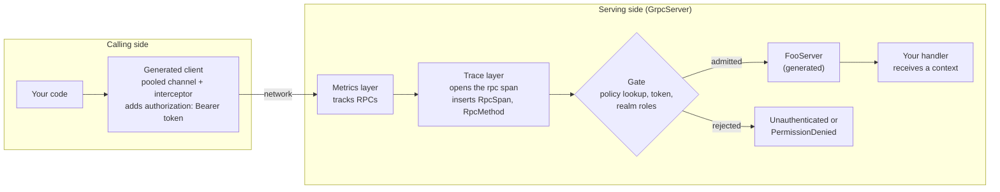

# Concepts

The mental model for `rust-grpc-lib`: what happens at build time and on each call, who enforces what, and a glossary. It assumes basic async Rust, not tonic, JWTs or Keycloak. For tasks, go to the guides: [Server](server.md), [Client](client.md), [Testing](testing.md), [Troubleshooting](troubleshooting.md).

## The pieces

**Build time.** `build.rs` calls `generate_protos`, which compiles every bundled controls `.proto` into `$OUT_DIR/proto.rs`. Per proto service it contains a tonic client (`FooClient`), a trait you implement (`Foo`) and a server type that wraps your implementation (`FooServer`). The protos come only from the org-wide [interface-definitions](https://github.com/fermi-ad/interface-definitions) repository, so all services and clients share one set of types. See [Generating the protos](server.md#generating-the-protos).

**One call at run time:**

The gate strips the `authorization` header on every path, so neither a handler nor a rejection ever sees the token.

## Who enforces what

- **The server enforces access.** `#[access_controlled_service]` declares one policy per method and emits the **policy table**; it checks nothing itself. `GrpcServer::add_service` accepts only annotated implementations and wraps each service in the **gate**, which validates the token and checks realm roles before any handler runs. A service cannot be served without a table, and auth cannot be switched off. The gate fails closed: a method missing from the table gets `PermissionDenied`.
- **The client chooses a constructor.** `public(url)` sends no token; `authenticated(url, provider)` asks the **token provider** for a token on every request. The target method's policy decides which; the gate is the authority. See [Call a service](client.md#call-a-service).
- **Metrics and tracing wrap routing**, so they see health checks and calls the gate rejects. Health bypasses the gate. See [Telemetry](server.md#telemetry).
- **Handlers get contexts.** `RequestContext<T>` (validated claims plus message) or, for `#[public]` methods, `PublicContext<T>` (message only), never a raw `tonic::Request`. Both dereference read-only to `CallInfo` (method, peer, metadata, span). See [Contexts](server.md#contexts).
- **Forwarding.** Inside a handler, `ctx.token()`, `ctx.forward(msg)` or `ctx.into_forwarded()` pass the caller's token to a downstream service, which validates it again. See [Forward the caller's token](client.md#forward-the-callers-token).

Token expiry is checked once, when a call starts. Long-lived streams and forwarding handlers should re-check `ctx.is_expired()`.

## Security assumption

Services operate over plaintext; the infra team handles TLS, not this library. Bearer tokens therefore travel unencrypted between your service and the platform's TLS layer, so a service must only be reachable through that layer and should bind to trusted interfaces. The library never logs tokens.

## Glossary

| Term | Meaning |
|---|---|
| Package to module | A proto `package a.b;` becomes the Rust module `a::b`, with tonic naming: `ExampleDB` in `package services.example;` is `proto::services::example::example_db_server::ExampleDbServer` |
| JWT / bearer token | A signed string saying who the caller is, sent as `authorization: Bearer <token>`. Anyone holding it can act as the caller |
| Keycloak, realm role | Keycloak signs the tokens. A realm role (such as `operator`) is listed in the token's `realm_access.roles`. **Only realm roles count**: a client role (`resource_access.<client>.roles`) never satisfies `#[roles(..)]` |
| Claims | The contents of a validated token: `KeycloakClaims`, with `sub` (who) and `exp` (expiry). In a handler: `ctx.claims`, `ctx.sub()`, `ctx.has_role(..)` |
| Token provider | Supplies tokens to send (`TokenProvider`): `FileTokenProvider` (a service's own identity, from a file, cached) or `ForwardedToken` (a user's token passed along; from `ctx.token()` or `ForwardedToken::new(..)`) |
| Token validator | Checks tokens (`TokenValidator`). `KeyValidator` verifies signatures against keys from a JWKS URL (`jwks-url` feature), a JWKS file, a PEM file or a string |
| Access policy | `#[roles(any(..))]`, `#[roles(all(..))]`, `#[any_authenticated]` or `#[public]`; exactly one per method |
| Policy table | What the macro emits: `ServicePolicy`, read through `PolicyTable`, with `MethodPolicy` entries holding an `Access` |
| Fail closed | When unsure, deny: a method missing from the table gets `PermissionDenied`; a context built without the gate gets `Internal` |
| Health | `grpc.health.v1.Health`, served automatically by `GrpcServer`; needs no token |
| Conformance check | `assert_policy_table_conforms` (`test-util`) calls a live server to check that it enforces its table. See [Testing](testing.md#check-policies-conformance) |

## More

- [Service template](https://github.com/fermi-ad/rust-grpc-service-template): a runnable example service built on this crate.
- [API docs](https://fermi-ad.github.io/rust-grpc-lib/rust_grpc_lib/index.html): every item.
